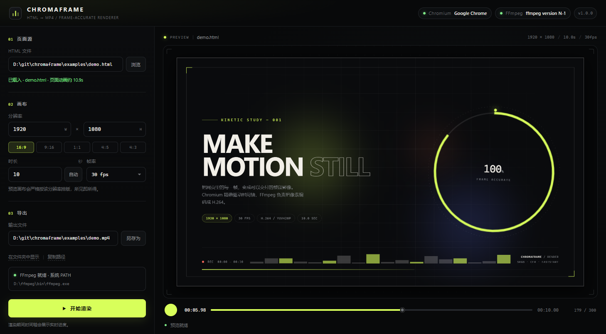

# Chromaframe

**把网页的每一帧，变成可交付的 MP4。**

Chromaframe 是一个 Windows 桌面工具：左侧选择本地 HTML、设置分辨率 / 时长 / 帧率，右侧用 Chromium 实时预览，点击“开始渲染”后由 Chromium 逐帧渲染，再通过 FFmpeg 编码为 H.264 MP4。



---

## 特性

- **内嵌 Chromium 窗口**：主界面运行在 WebView2 中（Windows 自带的 Chromium 内核），**不会打开或接管你的 Chrome / Edge 浏览器窗口**。
- **自动检测 FFmpeg**：依次检查环境变量、程序目录、缓存目录、`PATH`；找不到时在 Windows 上自动下载并解压 FFmpeg 到 `%LOCALAPPDATA%\Chromaframe\bin`。
- **所见即所得的分辨率**：输入宽高或点 16:9 / 9:16 / 1:1 等比例，右侧预览按目标分辨率等比缩放；渲染时用 Chromium 精确设置视口，像素尺寸就是导出尺寸。
- **CDN 资源等待**：渲染前等待 `load`、图片、字体、所有进行中的网络请求，并留出网络静默窗口；超时会明确报错，不会静默输出残缺页面。
- **精确时间轴**：注入页面时钟控制器，重写 `performance.now` / `Date.now` / `requestAnimationFrame`，暂停并 seek CSS / Web Animations，逐帧推进时间。
- **渲染期间锁定时间轴**：进度条不可拖动，但会显示当前帧、总帧数、速度、ETA 和实时画面。
- **无临时帧文件**：Chromium 截图以 JPEG 通过 stdin 直接送入 FFmpeg，磁盘上只产生最终 MP4。
- **命令行模式**：无界面渲染，方便集成到脚本 / CI。

---

## 环境要求

| 项目 | 要求 |
| --- | --- |
| 系统 | Windows 10 / 11（WebView2 通常随 Edge 安装） |
| 主界面 | Microsoft Edge WebView2 Runtime |
| 逐帧渲染 | Chrome 或 Edge（任意较新版本） |
| 编码 | FFmpeg（可自动下载） |
| 构建 | Go 1.22+（本项目使用 Go 1.26 验证） |

> 主窗口使用 **WebView2**，它是 Windows 内置的 Chromium 内核，因此不需要把 Chromium 源码克隆下来编译。渲染阶段会启动一个**隐藏的 headless Chromium**（Chrome/Edge），你在桌面上看不到浏览器窗口。

---

## 快速开始

### 直接运行

```powershell
.\Chromaframe.exe
```

程序会：

1. 检测 FFmpeg，缺失则自动下载；
2. 启动仅监听 `127.0.0.1` 的本地服务；
3. 在**内嵌 WebView2 窗口**中打开主界面。

### 从源码构建

```powershell
cd chromaframe
go build -trimpath -ldflags "-s -w" -o Chromaframe.exe .
.\Chromaframe.exe
```

或使用附带的脚本：

```powershell
.\build.ps1
```

> 注意：在包含多个 `main` 包的项目里执行 `go build ./...` 不会更新根目录的可执行文件，请使用上面的 `-o` 命令或 `build.ps1`。

### 命令行渲染

```powershell
.\Chromaframe.exe --render `
  --html examples\demo.html `
  --out out\demo.mp4 `
  --width 1920 --height 1080 `
  --duration 10 --fps 30
```

| 参数 | 说明 |
| --- | --- |
| `--html` | 输入 HTML 文件 |
| `--out` | 输出 MP4 路径 |
| `--width` / `--height` | 输出分辨率（必须为偶数） |
| `--duration` | 时长（秒） |
| `--fps` | 帧率 |
| `--verbose` | 输出调试日志到控制台 |
| `--no-browser` | 只启动本地服务，不打开主窗口（调试用） |
| `--port` | 指定 UI 服务端口，`0` 为随机 |
| `--version` | 显示版本 |

---

## 使用说明

1. **页面源**：点击“浏览”选择本地 `.html` 文件，或直接粘贴绝对路径后按回车。相对资源、ES Modules、字体和 CDN 资源都会从 HTML 所在目录提供服务。
2. **画布**：填写宽高，或点击比例按钮；修改后右侧预览立即按新比例缩放。时长可手动填写，也可点“自动”读取页面动画 / 视频时长。
3. **导出**：选择输出 MP4 路径。默认输出到 HTML 同目录的同名 `.mp4`。
4. **预览与拖动**：拖动底部进度条可定位页面时刻；点击播放按钮可预览动画。
5. **开始渲染**：渲染时进度条锁定，显示当前帧 / 总帧数与实时画面；可随时“取消渲染”。完成后会提示并可直接打开视频。

### 页面作者提示

为了让逐帧时间可控，Chromaframe 会：

- 在页面 `<head>` 注入控制脚本；
- 暂停并逐帧 seek CSS 动画 / Web Animations；
- 对 `<video>` / `<audio>` 做 `currentTime` seek；
- 用虚拟时间驱动 `requestAnimationFrame` 和 `Date.now` / `performance.now`。

推荐用 CSS 动画、Web Animations 或基于 `requestAnimationFrame` 且读取上述时钟的动画。**基于 `setTimeout` / `setInterval` 的动画不保证逐帧确定性**，因为这类定时器仍使用真实时间（为了保证 CDN / 分阶段加载不被冻结）。

可在 `<html>` 上标注建议时长：

```html
<html data-cf-duration="10">
```

### CDN 资源

页面从本地 HTTP 服务加载，因此外部 CDN 的脚本、样式、图片、字体都可以正常工作。渲染前会等待：

- `document.readyState === "complete"`；
- 所有 HTTP(S) 请求结束；
- 图片解码完成；
- `document.fonts.ready`；
- 最近一次网络活动后静默约 0.9 秒。

如果 90 秒内仍未完成，会报错并列出未完成的 URL。

---

## 工作原理

```
用户 HTML ──► 本地站点服务（注入 controller.js）
                     │
          WebView2 主界面（预览 / 拖动 / 设置）
                     │  POST /api/render
                     ▼
      headless Chromium + CDP（精确视口）
                     │  Page.captureScreenshot(JPEG)
                     ▼
             FFmpeg stdin ──► H.264 / yuv420p / +faststart
                     │
                     ▼
                  MP4 文件
```

- 主界面通过内嵌 WebView2 显示，本地服务只监听 `127.0.0.1`，每次启动随机 token，并校验 `X-CF-Token` / Cookie。
- 渲染使用独立临时 profile 的 headless Chromium，`Emulation.setDeviceMetricsOverride` 设置精确宽高。
- 每帧先 `setTime(t)`，等待控制器完成动画 seek / 媒体 seek / 双 rAF 绘制，再截图。
- FFmpeg 参数：`libx264`、`-crf 18`、`-preset medium`、`-pix_fmt yuv420p`、`-colorspace bt709`、`+faststart`。

---

## 项目结构

```text
chromaframe/
├── main.go                 # 入口、CLI、日志
├── app.go                  # 应用生命周期、浏览器检测、降级窗口
├── server.go               # 本地 UI / API 服务
├── site.go                 # 用户 HTML 站点服务与 controller.js 注入
├── render.go               # CDP 逐帧渲染 + FFmpeg 管道
├── browser.go              # Chrome / Edge 检测
├── ffmpeg.go               # FFmpeg 检测、自动下载、解压
├── dialog.go               # 原生文件 / 文件夹对话框
├── window_windows.go       # WebView2 内嵌主窗口
├── window_other.go         # 非 Windows 的窗口降级
├── assets/controller.js    # 注入页面的虚拟时钟控制器
├── web/                    # 主界面 HTML / CSS / JS
├── examples/demo.html      # 可直接渲染的演示动画
├── third_party/go-webview2 # 打过补丁的 WebView2 绑定
├── build.ps1
└── README.md
```

---

## FFmpeg 自动下载

检测顺序：

1. 环境变量 `CHROMAFRAME_FFMPEG`
2. 程序目录下的 `ffmpeg.exe`
3. `%LOCALAPPDATA%\Chromaframe\bin\ffmpeg.exe`
4. `PATH`
5. Windows 常见安装目录

缺失时会尝试下载：

- `CHROMAFRAME_FFMPEG_URL`（自定义 zip）
- BtbN FFmpeg-Builds（GitHub）
- gyan.dev essentials build

下载与解压进度会显示在左侧的 FFmpeg 卡片中。下载失败时会保留错误信息，并提示手动安装。也支持直接设置：

```powershell
$env:CHROMAFRAME_FFMPEG = 'D:\ffmpeg\bin\ffmpeg.exe'
```

## 渲染内核检测

按以下顺序查找 Chrome / Edge：

1. `CHROMAFRAME_CHROME`
2. Windows 常见安装路径（Chrome、Edge、Chromium）
3. `PATH`

如果找不到，请安装 Chrome/Edge，或设置：

```powershell
$env:CHROMAFRAME_CHROME = 'C:\Program Files\Google\Chrome\Application\chrome.exe'
```

---

## 常见问题

**窗口打不开 / 提示 WebView2 初始化失败**  
安装 [Microsoft Edge WebView2 Runtime](https://developer.microsoft.com/microsoft-edge/webview2/)，Windows 11 通常已自带。

**渲染失败：页面加载超时**  
通常是 CDN 资源无法访问。用 `--verbose` 查看日志中的未完成 URL；确认网络、代理或改用本地资源。

**视频第一帧是黑的**  
如果页面动画从透明开始，`t=0` 本来就没有内容。可拖动时间轴确认，或在页面里让首帧可见。

**没有声音**  
当前版本只导出视频轨道（`-an`）。需要音频时可自行移除该参数并增加音频输入。

**以 `setTimeout` 驱动的动画不准确**  
见上文“页面作者提示”。请改用 CSS / Web Animations / rAF。

日志位置：

```text
%LOCALAPPDATA%\Chromaframe\logs\chromaframe.log
```

---

## 已知限制

- 仅支持 Windows 的完整内嵌窗口；其他平台会退回“打开 Chromium 应用窗口”的方式。
- 导出视频不含音频。
- 依赖本机 Chrome/Edge 进行 headless 渲染。
- 逐帧渲染速度取决于页面复杂度与分辨率（1920×1080 / 30fps 的演示页约 7–8 帧/秒）。
- 页面里的 `setTimeout` 动画、Canvas 中依赖真实时间的逻辑可能无法完全确定性复现。

## License

MIT
